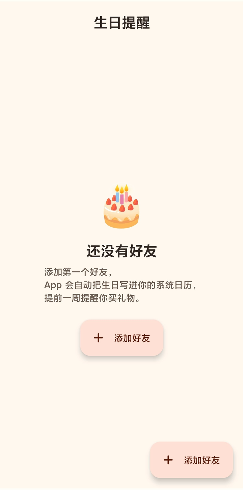
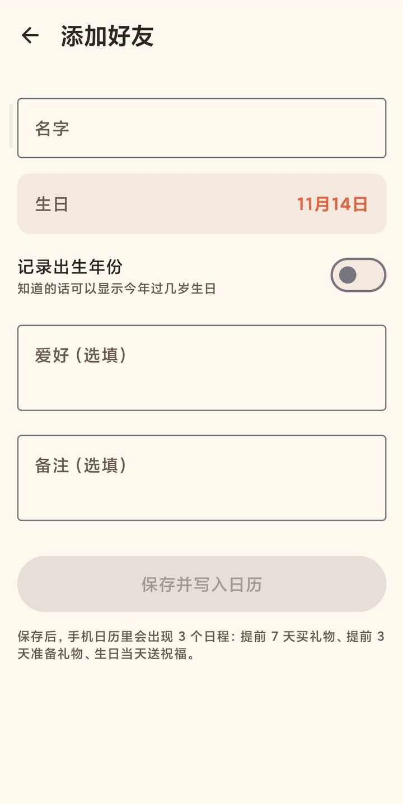
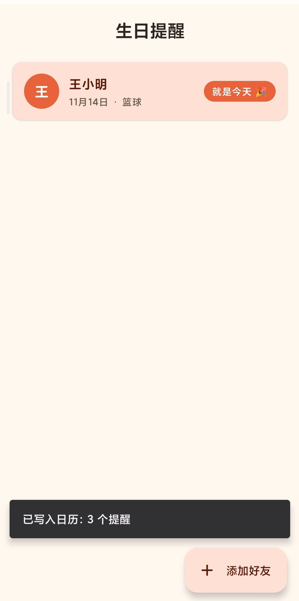
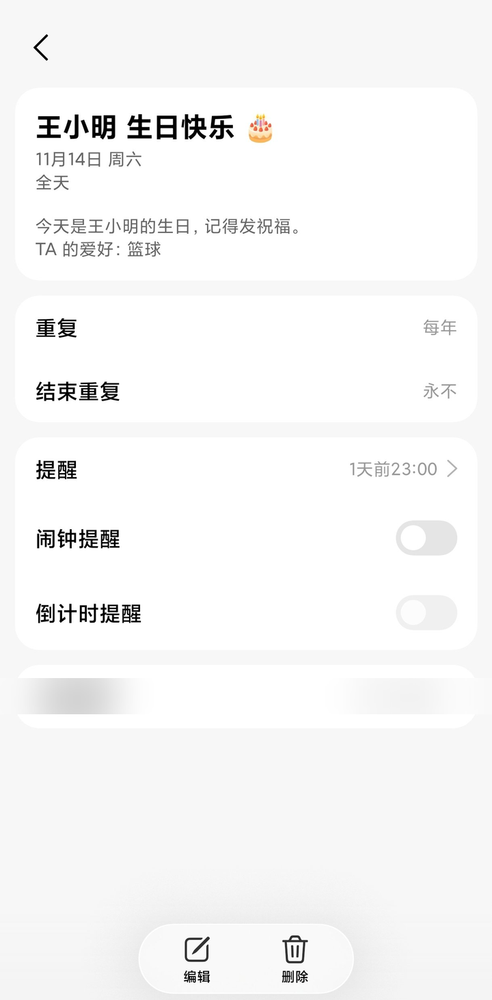
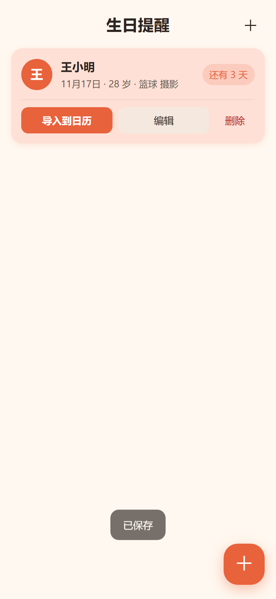

# 生日提醒 · Birthday Reminder

录入好友的名字、生日和爱好，**自动往手机系统日历里写入三条年度重复的提醒**：提前一周提醒买礼物、提前三天提醒准备、生日当天提醒发祝福。

纯本地运行，不联网、不上传、不需要注册账号。

## 界面预览

<p align="center">
  
  
  
  
</p>

<p align="center">
  <sub>空状态 → 添加好友 → 生日列表 → 写进手机系统日历</sub>
</p>

## 下载安装

**不想编译？直接下载 APK：**

👉 [**点此下载最新版**](https://github.com/AstanaAaa/birthday-reminder/releases/latest/download/BirthdayReminder.apk) （约 9.9 MB，点开即下载）

> 这个链接**永久有效**：每次发布新版本，只要附件名保持 `BirthdayReminder.apk`，同一个链接就会指向最新版。

**GitHub 下载慢的话**，在链接前面加一个加速镜像域名：

```
https://ghfast.top/https://github.com/AstanaAaa/birthday-reminder/releases/latest/download/BirthdayReminder.apk
```

备用镜像：`https://gh-proxy.com/` 、`https://ghproxy.net/`（用法相同，把官方地址整串拼在后面）

**安装说明**

- 要求 Android 8.0（API 26）及以上
- 首次安装需要在手机上允许「安装未知来源应用」
- 如果之前装过其他签名的版本，需要先卸载

**校验下载的文件**（可选，确认没被篡改）

```powershell
Get-FileHash .\BirthdayReminder.apk -Algorithm SHA256
```

v0.1.1 的 SHA-256：`91AC2C630AA40ACF2B6F29F3AC600806D0529B630360A8332098E4B6CA66B820`

## 网页版（iPhone 也能用）

安卓装 APK，**iPhone 用网页版**——不装任何 App，浏览器打开就行：

👉 **https://astanaa.github.io/birthday-reminder/**

用法：录入好友 → 点「导入到日历」→ 下载一个 `.ics` 文件 → 打开它 → 系统问「要把 3 个日程添加到日历吗」→ 点全部添加。

导入之后每年都会自动提醒，和装 App 效果一样。也可以「添加到主屏幕」，图标和 App 几乎没区别。

<p align="center">
  
</p>

**为什么 iOS 不用写原生 App**：iOS 的日历原生支持导入 `.ics` 标准格式，里面可以写「每年重复」和「提前多久提醒」。所以网页只负责生成正确的文件，剩下的交给系统日历——不需要 Xcode，不需要开发者账号，也不用过 App Store 审核。

> 网页版数据存在浏览器本地（localStorage），和安卓 App 各自独立，互不影响。

## 为什么做这个

我自己经常忘事。朋友生日前一天才想起来，礼物来不及买，只能发个红包糊弄过去。

市面上提醒类 App 的问题是要你**每天打开它**——但你恰恰想不起来打开。而日历是每个人每天都会看一眼的东西。所以这个 App 的定位很明确：

> 不做一个新的提醒 App，而是**把提醒塞进你已经在用的日历里**。

## 功能

- **三个自动日程**，写进手机系统日历（不是 App 内提醒）
  | 时间 | 日程 | 目的 |
  |---|---|---|
  | 生日前 7 天 | 给 XX 挑生日礼物 🎁 | 物流来得及 |
  | 生日前 3 天 | 准备 XX 的生日礼物 🎀 | 检查到货、包装 |
  | 生日当天 | XX 生日快乐 🎂 | 记得发祝福 |
- **每年自动重复**：用 iCalendar 的 `RRULE=FREQ=YEARLY`，一次写入永久生效，一年不开 App 提醒也还在
- **全天事件**：不占用你日历上的时间段，不跟会议冲突
- **按距离生日远近排序**，7 天内的好友高亮
- **记录爱好**，挑礼物时打开详情页看一眼就有数
- 2 月 29 日生日的人在平年自动落到 2 月 28 日

## 技术栈

| 层 | 选型 | 说明 |
|---|---|---|
| 语言 | Kotlin 1.9 | |
| UI | Jetpack Compose + Material 3 | 状态驱动，数据一变界面自动重画 |
| 日历 | `CalendarContract` | 直接调系统 ContentProvider |
| 存储 | JSON 文件（`org.json`） | 数据量小，不用 Room，文件可直接查看 |
| 最低版本 | Android 8.0（API 26） | 为了直接用 `java.time` |

## 编译

**环境要求**

- JDK 17
- Android SDK：platform 34、build-tools 34.0.0

**步骤**

```bash
# 1. 告诉 Gradle 你的 SDK 在哪（二选一）
#    方式 A：环境变量
export ANDROID_HOME=/path/to/android-sdk
#    方式 B：项目根目录建 local.properties
echo "sdk.dir=/path/to/android-sdk" > local.properties

# 2. 编译（Gradle 由 wrapper 自动下载，不用自己装）
./gradlew assembleDebug

# 3. 装到手机
adb install -r app/build/outputs/apk/debug/app-debug.apk
```

Windows 用户可以直接用 `build.ps1`，它只是把上面两步包了一下：

```powershell
.\build.ps1            # 编译
.\build.ps1 -Install   # 编译并安装到已连接的手机
```

## 项目结构

```
app/src/main/java/com/xd/birthdayreminder/
├── MainActivity.kt              入口
├── data/
│   ├── Friend.kt                好友数据模型 + JSON 序列化
│   ├── BirthdayMath.kt          下次生日、倒计时、年龄计算
│   └── FriendRepository.kt      文件存储（原子写入）
├── calendar/
│   └── CalendarSync.kt          ⭐ 核心：写系统日历 + 加提醒
└── ui/
    ├── AppViewModel.kt          业务逻辑中枢
    ├── Theme.kt                 配色
    └── screens/                 三个页面
```

## 实现上的两个坑

**1. 全天事件的时间基准是 UTC 零点，提醒分钟数要取反**

Android 的全天事件 `DTSTART` 固定为 UTC 00:00，而 `Reminders.MINUTES` 的语义是「事件开始**之前**多少分钟」。

想让提醒落在本地 9:00，得先算本地 9:00 比 UTC 零点**晚**多少分钟，然后取负数（负数表示「开始之后」）：

```kotlin
val offsetMinutes = ZoneId.systemDefault().rules.getOffset(Instant.now()).totalSeconds / 60
// 北京 UTC+8：本地 9:00 = UTC 01:00，比 UTC 零点晚 60 分钟 → 写 -60
val minutes = -(9 * 60 - offsetMinutes)
```

> 这里踩过坑：一开始写成 `+(9 * 60 - offsetMinutes)`，结果提醒落在前一天 23:00，差了整整一天。真机日历截图里一眼就能看出来。

**2. 提醒日期已经过去时要顺延到明年**

给一个明天就过生日的朋友录入信息时，"提前 7 天买礼物"这个时间点已经过去了。如果照写会在日历里插一条过去日期的日程，所以顺延一年。

## 已知限制

- 只支持公历（数据模型已预留 `calendarType` 字段）
- 各家手机厂商的日历 App 对"全天事件 + 闹钟"的处理不一致，提醒可能被合并或延后
- 没有云端同步，换手机需要重新录入
- 数据存在 App 私有目录，卸载即丢失

## Roadmap

- [ ] 导出 / 导入 JSON（解决换手机和误删）
- [ ] 农历生日支持
- [ ] 按爱好给礼物建议
- [ ] 好友搜索
- [ ] 桌面小组件（显示最近生日）

## 贡献

欢迎提 Issue 和 PR。提交前请确保 `./gradlew assembleDebug` 能通过。

## 许可证

[MIT](LICENSE)
